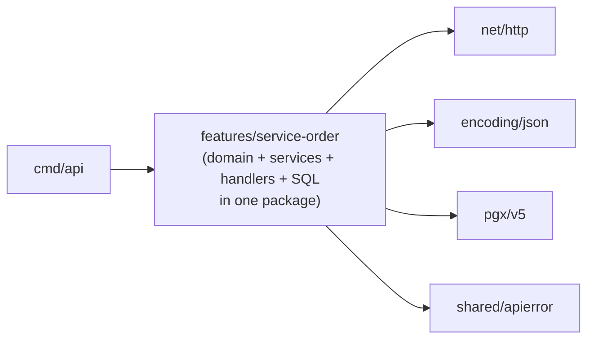
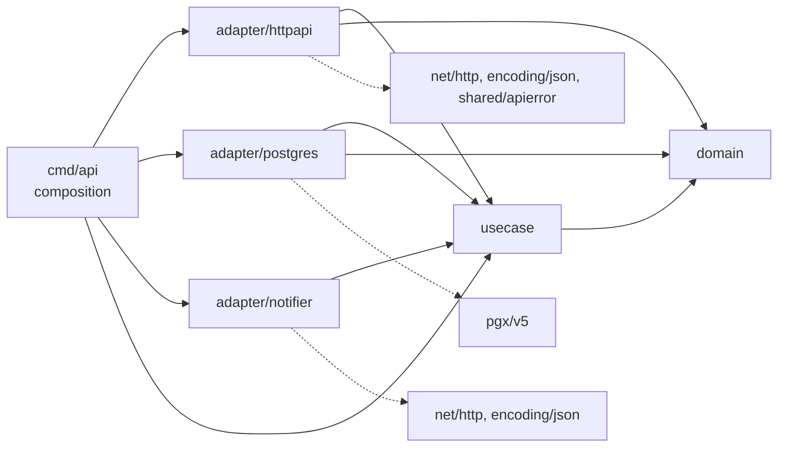

# Dependency map — before/after F2-US01

Evidence for story F2-US01 (Clean Architecture refactor of `service-order`,
[specs/service-order-architecture-refactor/](../specs/service-order-architecture-refactor/)).
It records the dependency graph before and after the refactor, the inventory of the other
modules, and how to regenerate both.

"Infrastructure" below means `net/http`, `encoding/json`, `github.com/jackc/pgx/v5/...`,
and the shared HTTP and database helpers (`internal/shared/apierror`, `httpx`, `database`,
`middleware`, `token`).

## 1. `service-order`, package level

### Before (commit `afeeb1e`, one flat package)



The `ServiceOrder` aggregate and every business rule were in the same Go package as
`net/http`, `pgx` and `apierror`, so nothing in the language prevented a business rule from
calling them. Every use case depended on the 20-method `serviceOrderLookups` interface.

| Package | Infrastructure imports |
| --- | --- |
| `features/service-order` | `net/http`, `encoding/json`, `pgx/v5`, `pgx/v5/pgxpool`, `shared/apierror` |

### After (this branch)



| Package | Infrastructure imports | Inner layers it imports |
| --- | --- | --- |
| `service-order` (root) | none (doc + architecture test) | — |
| `service-order/domain` | **none** | — |
| `service-order/usecase` | **none** | `domain` |
| `service-order/adapter/postgres` | `pgx/v5`, `pgx/v5/pgxpool` | `domain`, `usecase` |
| `service-order/adapter/httpapi` | `net/http`, `encoding/json`, `shared/apierror` | `domain`, `usecase` |
| `service-order/adapter/notifier` | `net/http`, `encoding/json` | `usecase` |

Every arrow points inward. `domain` reaches only the standard library and
`github.com/google/uuid`; `usecase` reaches only `domain`, the standard library, `uuid`,
`shared/document` and `shared/trackingtoken`, neither of which imports infrastructure. The
20-method interface is replaced by 17 ports of 1 to 4 methods, declared in
`usecase/ports.go` by their consumers
([design.md §9.2](../specs/service-order-architecture-refactor/design.md)).

**Enforcement.** `internal/features/service-order/architecture_test.go` resolves this graph
transitively with `go list -deps` on every `go test ./...`. It was checked to fail on
`domain → net/http` (direct), on `usecase → domain → net/http` (transitive) and on
`usecase → shared/token → golang-jwt` (library not on the allowlist).

## 2. Inventory of the other modules

Two levels are checked ([requirements.md §7.1](../specs/service-order-architecture-refactor/requirements.md)):

- **File level.** Does a business-rule file (`model.go`, `service.go`, `errors.go`) import
  infrastructure, or is a port declared in an adapter file instead of in its consumer?
- **Package level.** The rule evaluated per Go package, which is the only unit Go resolves.

| Module | Business files import infra? | Port declared in | Package level | Action in F2-US01 |
| --- | --- | --- | --- | --- |
| `auth` | no | `service.go` (`UserFinder`, `TokenIssuer`) ✔ | violates: handler (`net/http`, `httpx`) + repository (`pgx`) share the package | debt, recorded |
| `customer` | no | `repository.go` ✘ | violates (same reason, `apierror`) | **port moved to `service.go`**; package level is debt |
| `vehicle` | no | `repository.go` ✘ (`CustomerLookup` already in `service.go`) | violates | **port moved to `service.go`**; package level is debt |
| `product` | no | `repository.go` ✘ | violates | **port moved to `service.go`**; package level is debt |
| `service-catalog` | no | `service.go` (`Store`) ✔ | violates (`apierror`, `httpx`, `pgx`) | debt, recorded |
| `service-order-tracking` | no | `service.go` (`TrackingRepository`) ✔ | violates (`apierror`, `pgx`) | debt, recorded |

A `dto.go` importing `apierror` (customer, vehicle, product) is **not** counted as a
violation: request/response shapes and their structural validation are HTTP-layer code.

Every module's import list is unchanged at package level, because the port move happens
inside one package:

| Package | Infrastructure imports (before = after) |
| --- | --- |
| `features/auth` | `net/http`, `encoding/json`, `pgx/v5`, `pgx/v5/pgxpool`, `shared/httpx`, `shared/middleware` |
| `features/customer` | `net/http`, `encoding/json`, `pgx/v5`, `pgx/v5/pgconn`, `pgx/v5/pgxpool`, `shared/apierror` |
| `features/vehicle` | `net/http`, `encoding/json`, `pgx/v5`, `pgx/v5/pgconn`, `pgx/v5/pgxpool`, `shared/apierror` |
| `features/product` | `net/http`, `encoding/json`, `pgx/v5`, `pgx/v5/pgconn`, `pgx/v5/pgxpool`, `shared/apierror` |
| `features/service-catalog` | `net/http`, `encoding/json`, `pgx/v5`, `pgx/v5/pgconn`, `pgx/v5/pgxpool`, `shared/apierror`, `shared/httpx` |
| `features/service-order-tracking` | `net/http`, `encoding/json`, `pgx/v5`, `pgx/v5/pgxpool`, `shared/apierror` |

**Scope decision (team, 2026-10-21).** Package-level layering of these six modules is
explicitly out of scope for F2-US01 and stays as technical debt
([requirements.md §7.2](../specs/service-order-architecture-refactor/requirements.md),
[specs/architecture.md](../specs/architecture.md)). Bringing one of them into compliance
means repeating the `service-order` recipe: `domain/` + `usecase/` + `adapter/*`, then
adding the module to `architecture_test.go`'s checks.

## 3. How to regenerate

Package level (run at the repository root; on an older commit, use `git worktree add`):

```bash
go list -f '{{.ImportPath}}: {{join .Imports " "}}' ./internal/features/...
```

Transitive closure of one layer:

```bash
go list -deps -f '{{.ImportPath}} {{.Standard}}' ./internal/features/service-order/usecase
```

File level (which files import infrastructure):

```bash
for f in internal/features/*/*.go; do
  case $f in *_test.go) continue;; esac
  echo "$f: $(go list -f '{{join .Imports " "}}' "$f")"
done
```
